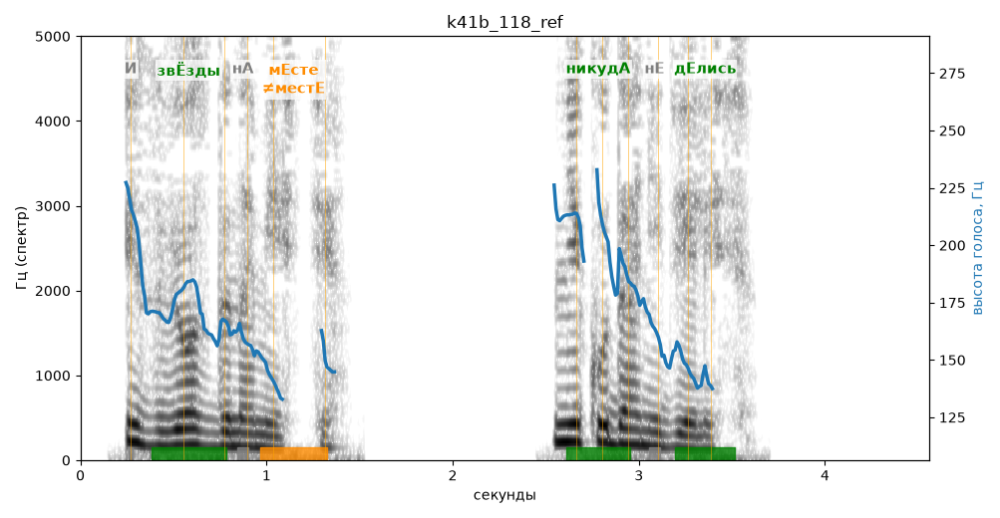

# k41b_118_ref

Голос: **edge:ru-RU-SvetlanaNeural** · длительность 4.6 с
Эталон: И звёзды на месте! Никуда не делись!
Распознано: Извезда на месте. Никуда не делись.
Расхождения в словах: «и звезды» → «извезда»

## Ударения
(где нужно: ruaccent)

| слово | нужно | у голоса | |
|---|---|---|---|
| звёзды | звЁзды | звЁзды | ✓ |
| месте | мЕсте | местЕ | ✗? возможно — послушать |
| никуда | никудА | никудА | ✓ |
| делись | дЕлись | дЕлись | ✓ |

## Интонация
- ✓ «и звёзды на месте!» — выделено слово «и» (+4.0 пт)
- ✗ «никуда не делись!» — восклицание звучит ровно, без эмоции
- Диапазон голоса 7.4 полутонов (живо), средняя высота 167 Гц

## Паузы и темп
- паузы на своих местах
- Темп 6.1 слога/с (нормально)

_Синяя линия — высота голоса. Над словами заглавная буква — где ударение должно быть; красным — голос поставил не туда (уверенно), оранжевым — возможно._
