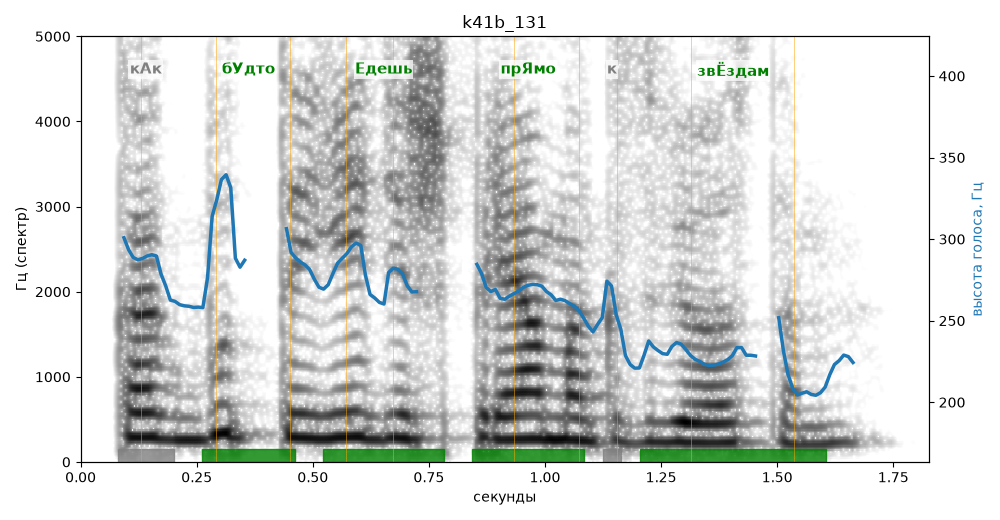

# k41b_131

Эталон: Как будто едешь прямо к звёздам!
Распознано: Как будто едешь прямо к звёстам.
Расхождения в словах: «звездам» → «звестам»

## Ударения
(где нужно: ruaccent)

| слово | нужно | у голоса | |
|---|---|---|---|
| будто | бУдто | бУдто | ✓ |
| едешь | Едешь | Едешь | ✓ |
| прямо | прЯмо | прЯмо | ✓ |
| звёздам | звЁздам | звЁздам | ✓ |

## Интонация
- ✗ «как будто едешь прямо к звёздам!» — восклицание звучит ровно, без эмоции
- Диапазон голоса 6.2 полутонов (нормально), средняя высота 262 Гц

## Паузы и темп
- паузы на своих местах
- Темп 6.6 слога/с (быстро)

_Синяя линия — высота голоса. Над словами заглавная буква — где ударение должно быть; красным — голос поставил не туда (уверенно), оранжевым — возможно._
