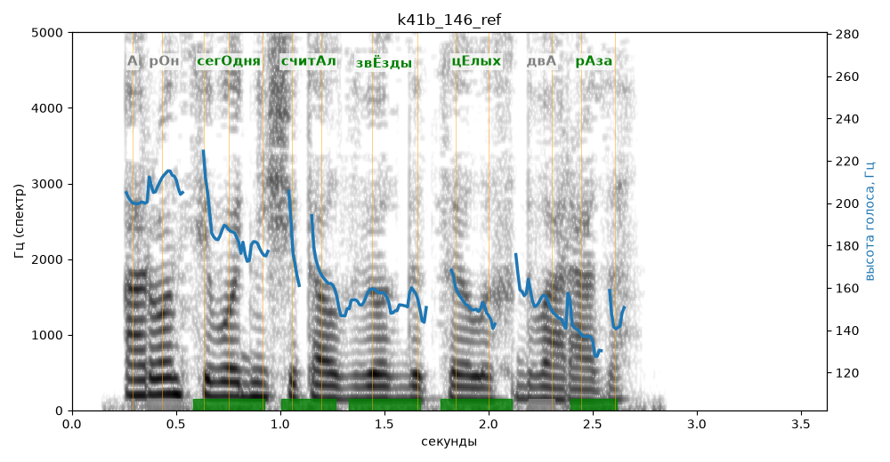

# k41b_146_ref

Голос: **edge:ru-RU-SvetlanaNeural** · длительность 3.6 с
Эталон: А Рон сегодня считал звёзды целых два раза!
Распознано: Арон сегодня считал звезды целых два раза.
Расхождения в словах: «а рон» → «арон»

## Ударения
(где нужно: ruaccent)

| слово | нужно | у голоса | |
|---|---|---|---|
| сегодня | сегОдня | сегОдня | ✓ |
| считал | считАл | считАл | ✓ |
| звёзды | звЁзды | звЁзды | ✓ |
| целых | цЕлых | цЕлых | ✓ |
| раза | рАза | рАза | ✓ |

## Интонация
- ✓ «а рон сегодня считал звёзды целых два раза!» — выделено слово «рон» (+5.0 пт)
- Диапазон голоса 7.3 полутонов (живо), средняя высота 158 Гц

## Паузы и темп
- паузы на своих местах
- Темп 6.0 слога/с (нормально)

_Синяя линия — высота голоса. Над словами заглавная буква — где ударение должно быть; красным — голос поставил не туда (уверенно), оранжевым — возможно._
