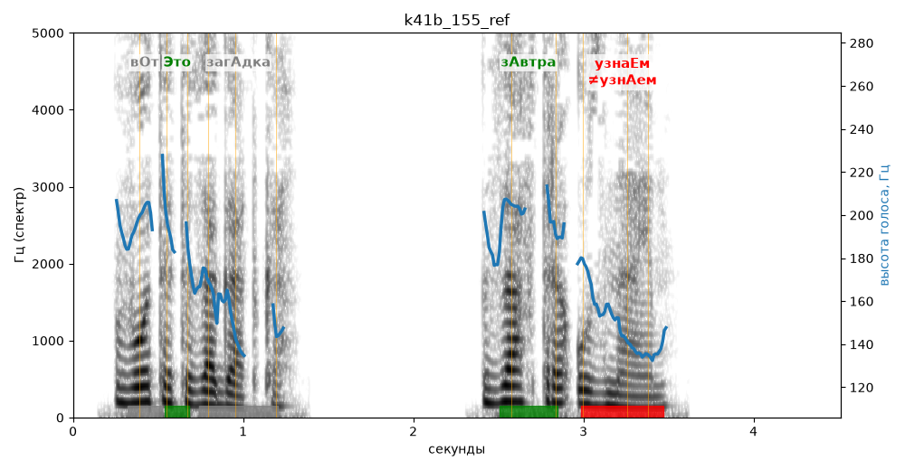

# k41b_155_ref

Голос: **edge:ru-RU-SvetlanaNeural** · длительность 4.5 с
Эталон: Вот это загадка! Завтра узнаем!
Распознано: Вот эта загадка. Завтра узнаем.
Расхождения в словах: «это» → «эта»

## Ударения
(где нужно: ruaccent)

| слово | нужно | у голоса | |
|---|---|---|---|
| это | Это | Это | ✓ |
| загадка | загАдка | зАгадка | ? не разобрать |
| завтра | зАвтра | зАвтра | ✓ |
| узнаем | узнаЕм | узнАем | ✗ ОШИБКА |

## Интонация
- ✓ «вот это загадка!» — выделено слово «вот» (+2.7 пт)
- ✓ «завтра узнаем!» — выделено слово «завтра» (+3.2 пт)
- Диапазон голоса 7.3 полутонов (живо), средняя высота 171 Гц

## Паузы и темп
- паузы на своих местах
- Темп 6.0 слога/с (нормально)

_Синяя линия — высота голоса. Над словами заглавная буква — где ударение должно быть; красным — голос поставил не туда (уверенно), оранжевым — возможно._
