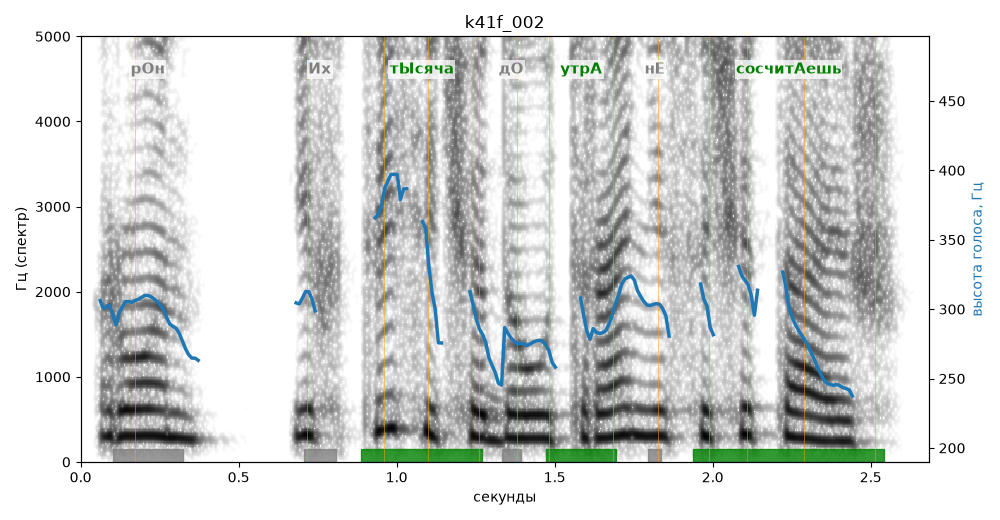

# k41f_002

Эталон: Рон, их тысяча! До утра не сосчитаешь!
Распознано: Рон, их тысяча до утра не сочетаешь.
Расхождения в словах: «сосчитаешь» → «сочетаешь»

## Ударения
(где нужно: ruaccent)

| слово | нужно | у голоса | |
|---|---|---|---|
| тысяча | тЫсяча | тЫсяча | ✓ |
| утра | утрА | утрА | ✓ |
| сосчитаешь | сосчитАешь | сосчитАешь | ✓ |

## Интонация
- ✓ «рон их тысяча!» — выделено слово «тысяча» (+4.0 пт)
- ✗ «до утра не сосчитаешь!» — восклицание звучит ровно, без эмоции
- Диапазон голоса 7.4 полутонов (живо), средняя высота 296 Гц

## Паузы и темп
- после «тысяча!» пауза всего 0.06 с — фразы слипаются
- Темп 6.3 слога/с (нормально)

_Синяя линия — высота голоса. Над словами заглавная буква — где ударение должно быть; красным — голос поставил не туда (уверенно), оранжевым — возможно._
