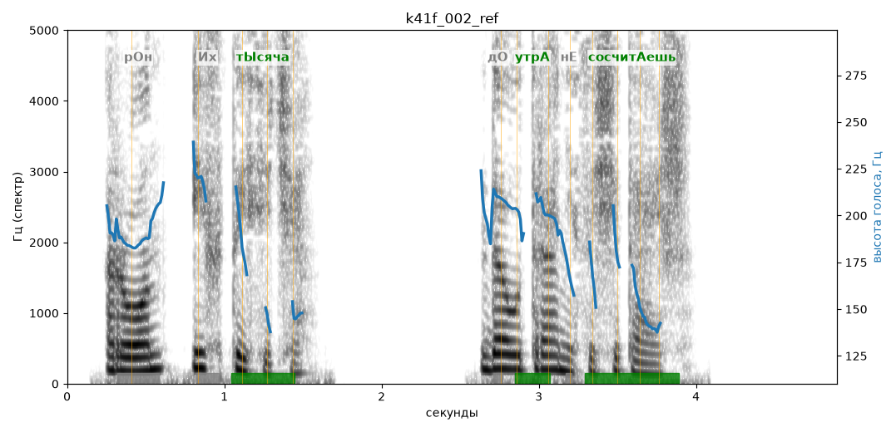

# k41f_002_ref

Голос: **edge:ru-RU-SvetlanaNeural** · длительность 4.9 с
Эталон: Рон, их тысяча! До утра не сосчитаешь!
Распознано: Рон, их тысяча. До утра не сосчитаешь.
Слова: все совпали

## Ударения
(где нужно: ruaccent)

| слово | нужно | у голоса | |
|---|---|---|---|
| тысяча | тЫсяча | тЫсяча | ✓ |
| утра | утрА | утрА | ✓ |
| сосчитаешь | сосчитАешь | сосчитАешь | ✓ |

## Интонация
- ✓ «рон их тысяча!» — выделено слово «их» (+3.0 пт)
- ✓ «до утра не сосчитаешь!» — выделено слово «до» (+2.6 пт)
- Диапазон голоса 7.5 полутонов (живо), средняя высота 189 Гц

## Паузы и темп
- паузы на своих местах
- Темп 6.3 слога/с (нормально)

_Синяя линия — высота голоса. Над словами заглавная буква — где ударение должно быть; красным — голос поставил не туда (уверенно), оранжевым — возможно._
