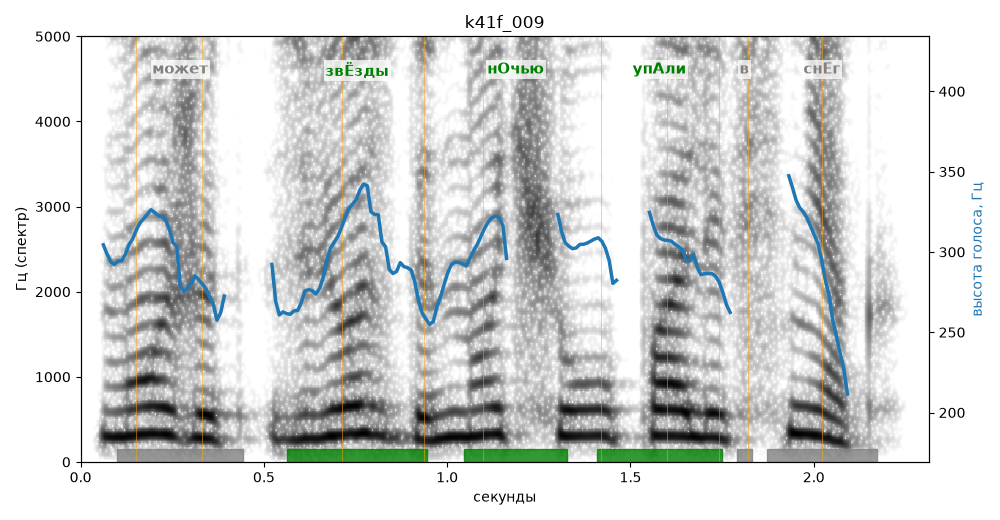

# k41f_009

Эталон: Может, звёзды ночью упали в снег?
Распознано: Может, звезды ночью упали в снег?
Слова: все совпали

## Ударения
(где нужно: ruaccent)

| слово | нужно | у голоса | |
|---|---|---|---|
| может | может | мОжет | нет эталона |
| звёзды | звЁзды | звЁзды | ✓ |
| ночью | нОчью | нОчью | ✓ |
| упали | упАли | упАли | ✓ |

## Интонация
- ✗ «может звёзды ночью упали в снег?» — нет вопросительного подъёма (самое высокое место — «может», в начале) — звучит как утверждение
- Диапазон голоса 4.2 полутонов (монотонно, как робот), средняя высота 296 Гц

## Паузы и темп
- паузы на своих местах
- Темп 4.8 слога/с (нормально)

_Синяя линия — высота голоса. Над словами заглавная буква — где ударение должно быть; красным — голос поставил не туда (уверенно), оранжевым — возможно._
