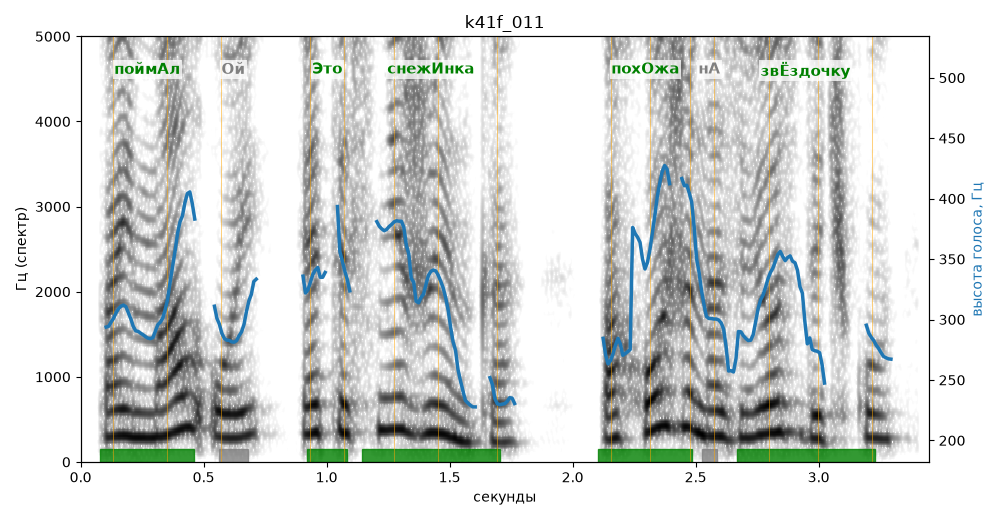

# k41f_011

Эталон: Поймал! Ой, это снежинка. Похожа на звёздочку!
Распознано: Поймал ой, это снежинка. Похоже на звездочку.
Расхождения в словах: «похожа» → «похоже»

## Ударения
(где нужно: ruaccent)

| слово | нужно | у голоса | |
|---|---|---|---|
| поймал | поймАл | поймАл | ✓ |
| это | Это | Это | ✓ |
| снежинка | снежИнка | снежИнка | ✓ |
| похожа | похОжа | похОжа | ✓ |
| звёздочку | звЁздочку | звЁздочку | ✓ |

## Интонация
- ✓ «ой это снежинка.» — конец фразы понижается — звучит законченно
- ✓ «похожа на звёздочку!» — выделено слово «похожа» (+4.1 пт)
- Диапазон голоса 9.3 полутонов (живо), средняя высота 309 Гц

## Паузы и темп
- после «поймал!» пауза всего 0.10 с — фразы слипаются
- Темп 6.0 слога/с (нормально)

_Синяя линия — высота голоса. Над словами заглавная буква — где ударение должно быть; красным — голос поставил не туда (уверенно), оранжевым — возможно._
