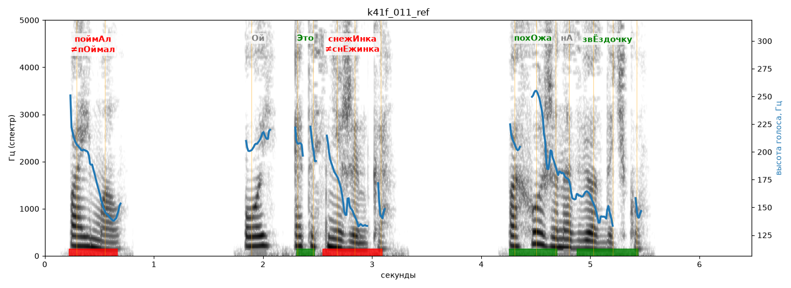

# k41f_011_ref

Голос: **edge:ru-RU-SvetlanaNeural** · длительность 6.5 с
Эталон: Поймал! Ой, это снежинка. Похожа на звёздочку!
Распознано: Поймал. Ой, это снежинка. Похоже на звездочку.
Расхождения в словах: «похожа» → «похоже»

## Ударения
(где нужно: ruaccent)

| слово | нужно | у голоса | |
|---|---|---|---|
| поймал | поймАл | пОймал | ✗ ОШИБКА |
| это | Это | Это | ✓ |
| снежинка | снежИнка | снЕжинка | ✗ ОШИБКА |
| похожа | похОжа | похОжа | ✓ |
| звёздочку | звЁздочку | звЁздочку | ✓ |

## Интонация
- ✓ «ой это снежинка.» — конец фразы понижается — звучит законченно
- ✓ «похожа на звёздочку!» — выделено слово «похожа» (+7.4 пт)
- Диапазон голоса 9.1 полутонов (живо), средняя высота 178 Гц

## Паузы и темп
- паузы на своих местах
- Темп 5.9 слога/с (нормально)

_Синяя линия — высота голоса. Над словами заглавная буква — где ударение должно быть; красным — голос поставил не туда (уверенно), оранжевым — возможно._
