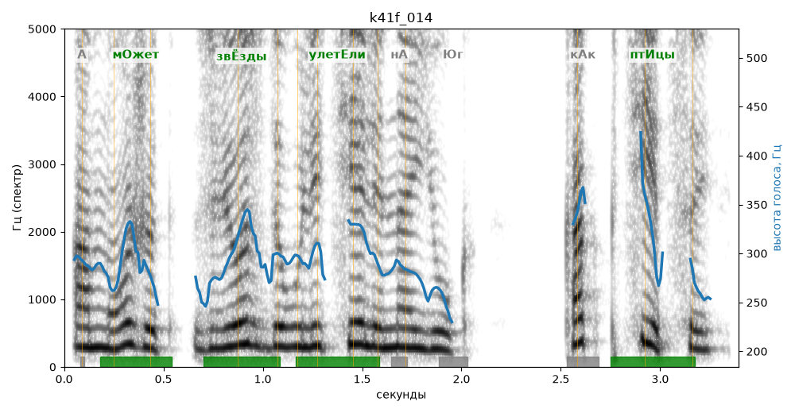

# k41f_014

Эталон: А может, звёзды улетели на юг? Как птицы!
Распознано: а может звезды улетели на юг. Как птицы?
Слова: все совпали

## Ударения
(где нужно: ruaccent)

| слово | нужно | у голоса | |
|---|---|---|---|
| может | мОжет | мОжет | ✓ |
| звёзды | звЁзды | звЁзды | ✓ |
| улетели | улетЕли | улетЕли | ✓ |
| птицы | птИцы | птИцы | ✓ |

## Интонация
- ✓ «а может звёзды улетели на юг?» — вопросительный подъём на слове «улетели»
- ✗ «как птицы!» — восклицание звучит ровно, без эмоции
- Диапазон голоса 5.3 полутонов (нормально), средняя высота 288 Гц

## Паузы и темп
- паузы на своих местах
- Темп 5.7 слога/с (нормально)

_Синяя линия — высота голоса. Над словами заглавная буква — где ударение должно быть; красным — голос поставил не туда (уверенно), оранжевым — возможно._
