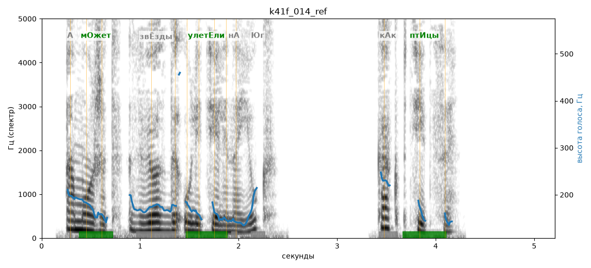

# k41f_014_ref

Голос: **edge:ru-RU-SvetlanaNeural** · длительность 5.2 с
Эталон: А может, звёзды улетели на юг? Как птицы!
Распознано: А может звезды улетели на юг? Как птицы?
Слова: все совпали

## Ударения
(где нужно: ruaccent)

| слово | нужно | у голоса | |
|---|---|---|---|
| может | мОжет | мОжет | ✓ |
| звёзды | звЁзды | звёздЫ | ? не разобрать |
| улетели | улетЕли | улетЕли | ✓ |
| птицы | птИцы | птИцы | ✓ |

## Интонация
- ✗ «а может звёзды улетели на юг?» — нет вопросительного подъёма (самое высокое место — «а», в начале) — звучит как утверждение
- ✓ «как птицы!» — выделено слово «как» (+6.3 пт)
- Диапазон голоса 8.0 полутонов (живо), средняя высота 167 Гц

## Паузы и темп
- паузы на своих местах
- Темп 5.4 слога/с (нормально)

_Синяя линия — высота голоса. Над словами заглавная буква — где ударение должно быть; красным — голос поставил не туда (уверенно), оранжевым — возможно._
