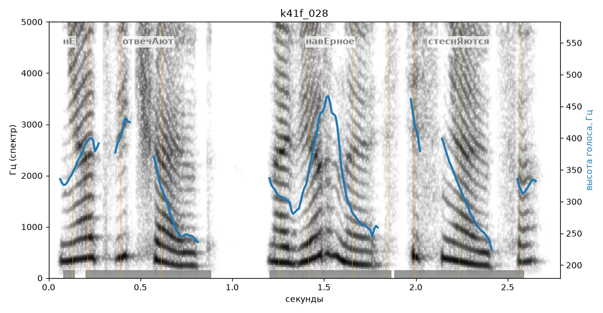

# k41f_028

Эталон: Не отвечают. Наверное, стесняются.
Распознано: Не отвечают, наверное, стесняются.
Слова: все совпали

## Ударения
(где нужно: ruaccent)

| слово | нужно | у голоса | |
|---|---|---|---|
| отвечают | отвечАют | — | ? |
| наверное | навЕрное | нАверное | ? не разобрать |
| стесняются | стеснЯются | — | ? |

## Интонация
- ✓ «не отвечают.» — конец фразы понижается — звучит законченно
- ✗ «наверное стесняются.» — конец фразы не понижается — звучит незаконченно / как перечисление
- Диапазон голоса 10.1 полутонов (живо), средняя высота 324 Гц

## Паузы и темп
- после «наверное,» нет паузы (0.02 с)
- Темп 5.0 слога/с (нормально)

_Синяя линия — высота голоса. Над словами заглавная буква — где ударение должно быть; красным — голос поставил не туда (уверенно), оранжевым — возможно._
