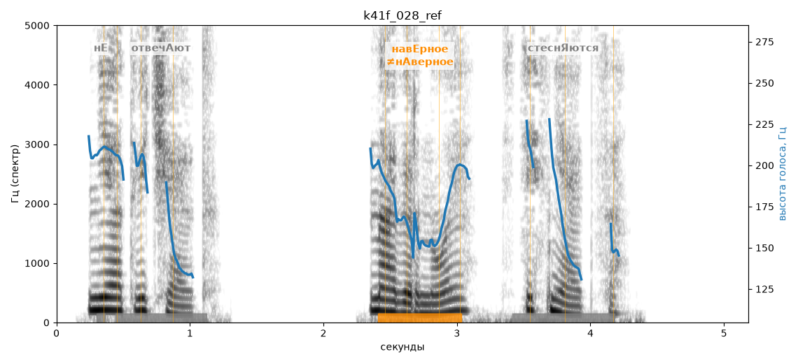

# k41f_028_ref

Голос: **edge:ru-RU-SvetlanaNeural** · длительность 5.2 с
Эталон: Не отвечают. Нав+ерное, стесняются.
Распознано: Не отвечают. Наверное, стесняется.
Расхождения в словах: «стесняются» → «стесняется»

## Ударения
(где нужно: ruaccent)

| слово | нужно | у голоса | |
|---|---|---|---|
| отвечают | отвечАют | — | ? |
| наверное | навЕрное | нАверное | ✗? возможно — послушать |
| стесняются | стеснЯются | — | ? |

## Интонация
- ✓ «не отвечают.» — конец фразы понижается — звучит законченно
- ✓ «наверное стесняются.» — конец фразы понижается — звучит законченно
- Диапазон голоса 7.7 полутонов (живо), средняя высота 181 Гц

## Паузы и темп
- паузы на своих местах
- Темп 5.0 слога/с (нормально)

_Синяя линия — высота голоса. Над словами заглавная буква — где ударение должно быть; красным — голос поставил не туда (уверенно), оранжевым — возможно._
