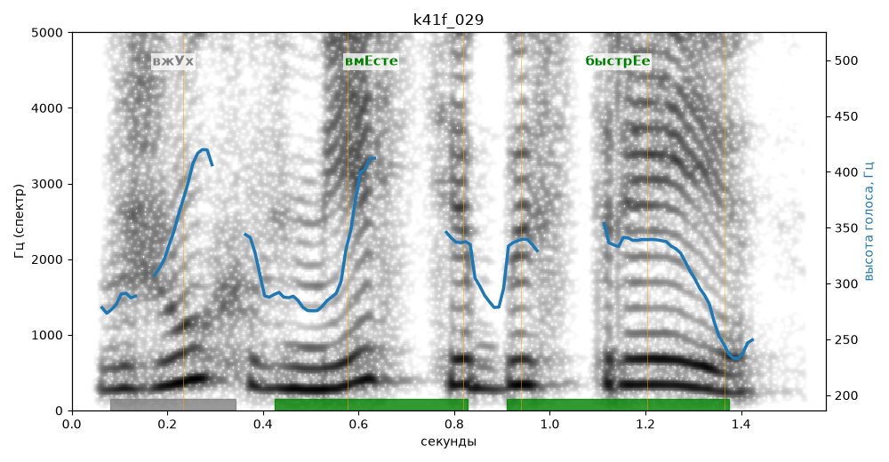

# k41f_029

Эталон: Вжух! Вместе быстрее!
Распознано: Вжух вместе быстрее.
Слова: все совпали

## Ударения
(где нужно: ruaccent)

| слово | нужно | у голоса | |
|---|---|---|---|
| вместе | вмЕсте | вмЕсте | ✓ |
| быстрее | быстрЕе | быстрЕе | ✓ |

## Интонация
- ✗ «вместе быстрее!» — восклицание звучит ровно, без эмоции
- Диапазон голоса 8.7 полутонов (живо), средняя высота 322 Гц

## Паузы и темп
- после «вжух!» пауза всего 0.08 с — фразы слипаются
- Темп 4.6 слога/с (нормально)

_Синяя линия — высота голоса. Над словами заглавная буква — где ударение должно быть; красным — голос поставил не туда (уверенно), оранжевым — возможно._
