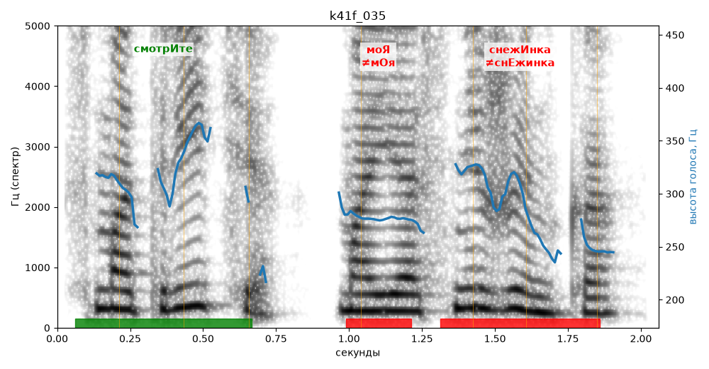

# k41f_035

Эталон: Смотрите, моя снежинка!
Распознано: Смотрите, моя снежинка.
Слова: все совпали

## Ударения
(где нужно: ruaccent)

| слово | нужно | у голоса | |
|---|---|---|---|
| смотрите | смотрИте | смотрИте | ✓ |
| моя | моЯ | мОя | ✗ ОШИБКА |
| снежинка | снежИнка | снЕжинка | ✗ ОШИБКА |

## Интонация
- ✓ «смотрите моя снежинка!» — выделено слово «смотрите» (+3.5 пт)
- Диапазон голоса 6.4 полутонов (нормально), средняя высота 285 Гц

## Паузы и темп
- паузы на своих местах
- Темп 4.7 слога/с (нормально)

_Синяя линия — высота голоса. Над словами заглавная буква — где ударение должно быть; красным — голос поставил не туда (уверенно), оранжевым — возможно._
