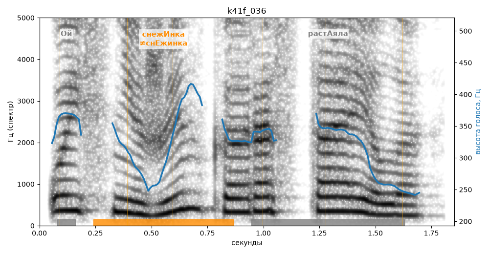

# k41f_036

Эталон: Ой! Снежинка растаяла!
Распознано: Ой, снежинка растаяла!
Слова: все совпали

## Ударения
(где нужно: ruaccent)

| слово | нужно | у голоса | |
|---|---|---|---|
| снежинка | снежИнка | снЕжинка | ✗? возможно — послушать |
| растаяла | растАяла | — | ? |

## Интонация
- ✗ «снежинка растаяла!» — восклицание звучит ровно, без эмоции
- Диапазон голоса 8.2 полутонов (живо), средняя высота 328 Гц

## Паузы и темп
- после «ой!» пауза всего 0.08 с — фразы слипаются
- Темп 4.5 слога/с (нормально)

_Синяя линия — высота голоса. Над словами заглавная буква — где ударение должно быть; красным — голос поставил не туда (уверенно), оранжевым — возможно._
