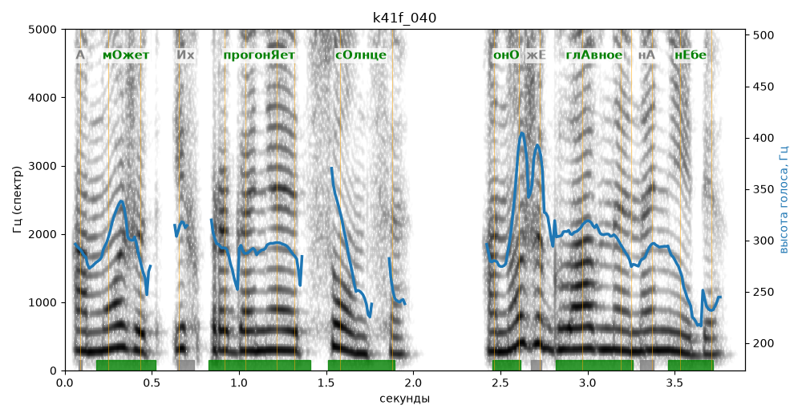

# k41f_040

Эталон: А может, их прогоняет солнце? Оно же главное на небе.
Распознано: а может их прогоняет солнце. Оно же главное на небе.
Слова: все совпали

## Ударения
(где нужно: ruaccent)

| слово | нужно | у голоса | |
|---|---|---|---|
| может | мОжет | мОжет | ✓ |
| прогоняет | прогонЯет | прогонЯет | ✓ |
| солнце | сОлнце | сОлнце | ✓ |
| оно | онО | онО | ✓ |
| главное | глАвное | глАвное | ✓ |
| небе | нЕбе | нЕбе | ✓ |

## Интонация
- ✗ «а может их прогоняет солнце?» — нет вопросительного подъёма (самое высокое место — «их», в начале) — звучит как утверждение
- ✓ «оно же главное на небе.» — конец фразы понижается — звучит законченно
- Диапазон голоса 7.2 полутонов (живо), средняя высота 293 Гц

## Паузы и темп
- паузы на своих местах
- Темп 6.2 слога/с (нормально)

_Синяя линия — высота голоса. Над словами заглавная буква — где ударение должно быть; красным — голос поставил не туда (уверенно), оранжевым — возможно._
