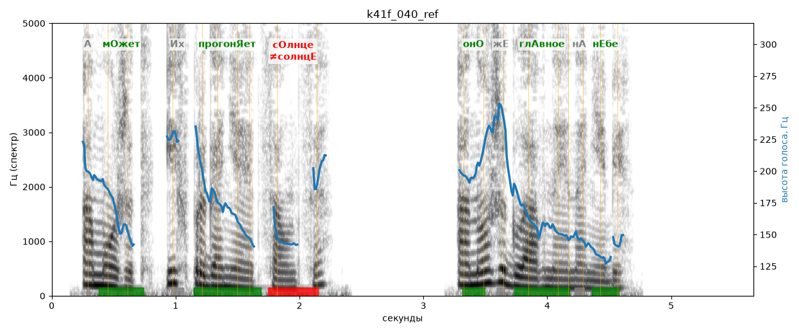

# k41f_040_ref

Голос: **edge:ru-RU-SvetlanaNeural** · длительность 5.7 с
Эталон: А может, их прогоняет с+олнце? Оно же главное на небе.
Распознано: А может, их прогоняет солнце? А ножи главные на небе.
Расхождения в словах: «оно же главное» → «а ножи главные»

## Ударения
(где нужно: ruaccent)

| слово | нужно | у голоса | |
|---|---|---|---|
| может | мОжет | мОжет | ✓ |
| прогоняет | прогонЯет | прогонЯет | ✓ |
| солнце | сОлнце | солнцЕ | ✗ ОШИБКА |
| оно | онО | онО | ✓ |
| главное | глАвное | глАвное | ✓ |
| небе | нЕбе | нЕбе | ✓ |

## Интонация
- ✓ «а может их прогоняет солнце?» — вопросительный подъём на слове «их»
- ✓ «оно же главное на небе.» — конец фразы понижается — звучит законченно
- Диапазон голоса 9.1 полутонов (живо), средняя высота 168 Гц

## Паузы и темп
- паузы на своих местах
- Темп 6.5 слога/с (нормально)

_Синяя линия — высота голоса. Над словами заглавная буква — где ударение должно быть; красным — голос поставил не туда (уверенно), оранжевым — возможно._
