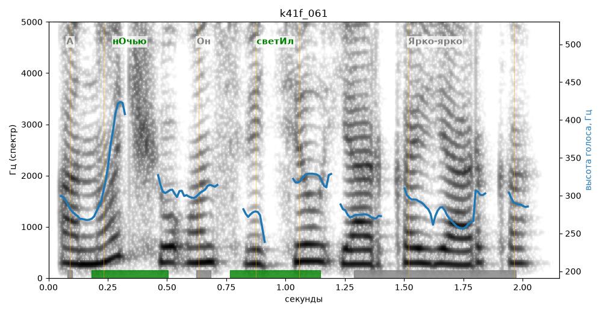

# k41f_061

Эталон: А ночью он светил ярко-ярко.
Распознано: Оно, чьу он светил ярко ярко.
Расхождения в словах: «а ночью» → «оно чьу»; «ярко-ярко» → «ярко ярко»

## Ударения
(где нужно: ruaccent)

| слово | нужно | у голоса | |
|---|---|---|---|
| ночью | нОчью | нОчью | ✓ |
| светил | светИл | светИл | ✓ |
| ярко-ярко | Ярко-ярко | — | ? |

## Интонация
- ✗ «а ночью он светил ярко-ярко.» — конец фразы не понижается — звучит незаконченно / как перечисление
- Диапазон голоса 4.5 полутонов (нормально), средняя высота 291 Гц

## Паузы и темп
- паузы на своих местах
- Темп 3.7 слога/с (медленно)

_Синяя линия — высота голоса. Над словами заглавная буква — где ударение должно быть; красным — голос поставил не туда (уверенно), оранжевым — возможно._
