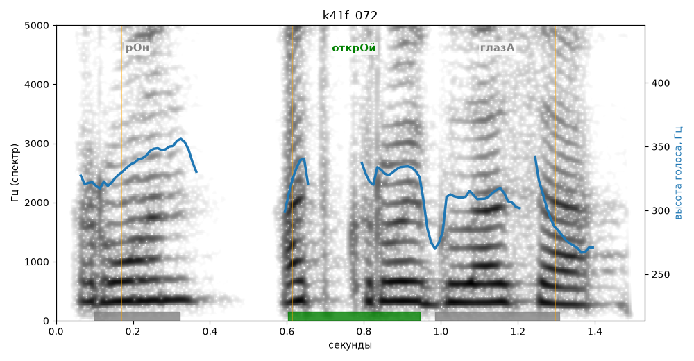

# k41f_072

Эталон: Рон, открой глаза!
Распознано: Рон, открой глаза.
Слова: все совпали

## Ударения
(где нужно: ruaccent)

| слово | нужно | у голоса | |
|---|---|---|---|
| открой | открОй | открОй | ✓ |
| глаза | глазА | глАза | ? не разобрать |

## Интонация
- ✗ «рон открой глаза!» — восклицание звучит ровно, без эмоции
- Диапазон голоса 4.4 полутонов (монотонно, как робот), средняя высота 321 Гц

## Паузы и темп
- паузы на своих местах
- Темп 5.4 слога/с (нормально)

_Синяя линия — высота голоса. Над словами заглавная буква — где ударение должно быть; красным — голос поставил не туда (уверенно), оранжевым — возможно._
