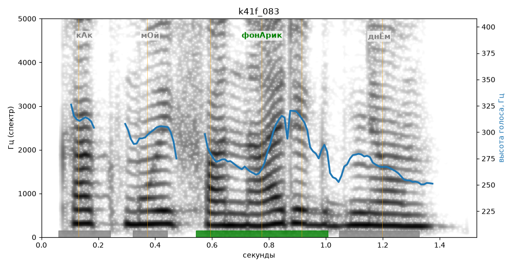

# k41f_083

Эталон: Как мой фонарик днём!
Распознано: Как мой фанарик днем?
Расхождения в словах: «фонарик» → «фанарик»

## Ударения
(где нужно: ruaccent)

| слово | нужно | у голоса | |
|---|---|---|---|
| фонарик | фонАрик | фонАрик | ✓ |

## Интонация
- ✗ «как мой фонарик днём!» — восклицание звучит ровно, без эмоции
- Диапазон голоса 3.9 полутонов (монотонно, как робот), средняя высота 278 Гц

## Паузы и темп
- паузы на своих местах
- Темп 4.7 слога/с (нормально)

_Синяя линия — высота голоса. Над словами заглавная буква — где ударение должно быть; красным — голос поставил не туда (уверенно), оранжевым — возможно._
