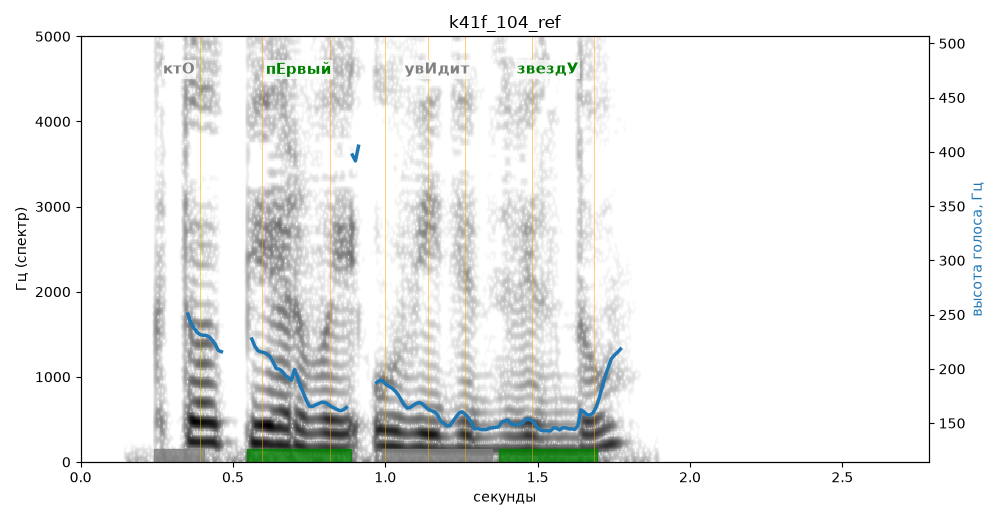

# k41f_104_ref

Голос: **edge:ru-RU-SvetlanaNeural** · длительность 2.8 с
Эталон: Кто первый увидит звезду?
Распознано: Кто первый увидит звезду?
Слова: все совпали

## Ударения
(где нужно: ruaccent)

| слово | нужно | у голоса | |
|---|---|---|---|
| первый | пЕрвый | пЕрвый | ✓ |
| увидит | увИдит | Увидит | ? не разобрать |
| звезду | звездУ | звездУ | ✓ |

## Интонация
- ✓ «кто первый увидит звезду?» — конец фразы понижается — звучит законченно
- Диапазон голоса 8.3 полутонов (живо), средняя высота 165 Гц

## Паузы и темп
- паузы на своих местах
- Темп 5.5 слога/с (нормально)

_Синяя линия — высота голоса. Над словами заглавная буква — где ударение должно быть; красным — голос поставил не туда (уверенно), оранжевым — возможно._
