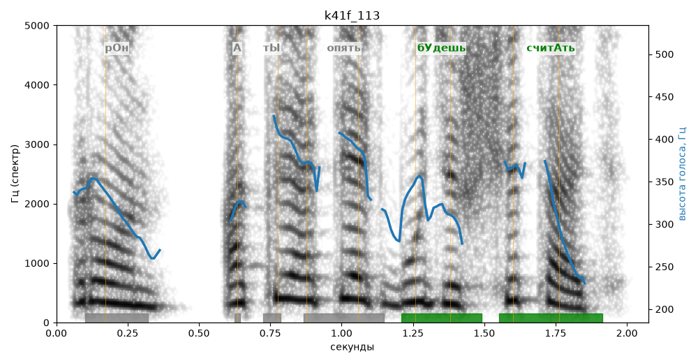

# k41f_113

Эталон: Рон, а ты опять будешь считать?
Распознано: Рон, а ты опять будешь считать?
Слова: все совпали

## Ударения
(где нужно: ruaccent)

| слово | нужно | у голоса | |
|---|---|---|---|
| опять | опять | опЯть | нет эталона |
| будешь | бУдешь | бУдешь | ✓ |
| считать | считАть | считАть | ✓ |

## Интонация
- ✓ «рон а ты опять будешь считать?» — вопросительный подъём на слове «ты»
- Диапазон голоса 7.6 полутонов (живо), средняя высота 329 Гц

## Паузы и темп
- паузы на своих местах
- Темп 6.0 слога/с (нормально)

_Синяя линия — высота голоса. Над словами заглавная буква — где ударение должно быть; красным — голос поставил не туда (уверенно), оранжевым — возможно._
