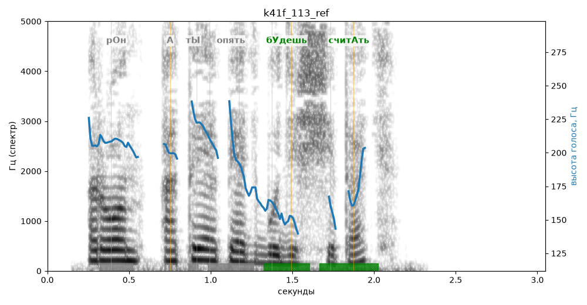

# k41f_113_ref

Голос: **edge:ru-RU-SvetlanaNeural** · длительность 3.0 с
Эталон: Рон, а ты опять будешь считать?
Распознано: Рон, а ты опять будешь считать?
Слова: все совпали

## Ударения
(где нужно: ruaccent)

| слово | нужно | у голоса | |
|---|---|---|---|
| опять | опять | опЯть | нет эталона |
| будешь | бУдешь | бУдешь | ✓ |
| считать | считАть | считАть | ✓ |

## Интонация
- ✗ «рон а ты опять будешь считать?» — нет вопросительного подъёма (самое высокое место — «ты», в начале) — звучит как утверждение
- Диапазон голоса 7.0 полутонов (живо), средняя высота 199 Гц

## Паузы и темп
- паузы на своих местах
- Темп 6.1 слога/с (нормально)

_Синяя линия — высота голоса. Над словами заглавная буква — где ударение должно быть; красным — голос поставил не туда (уверенно), оранжевым — возможно._
