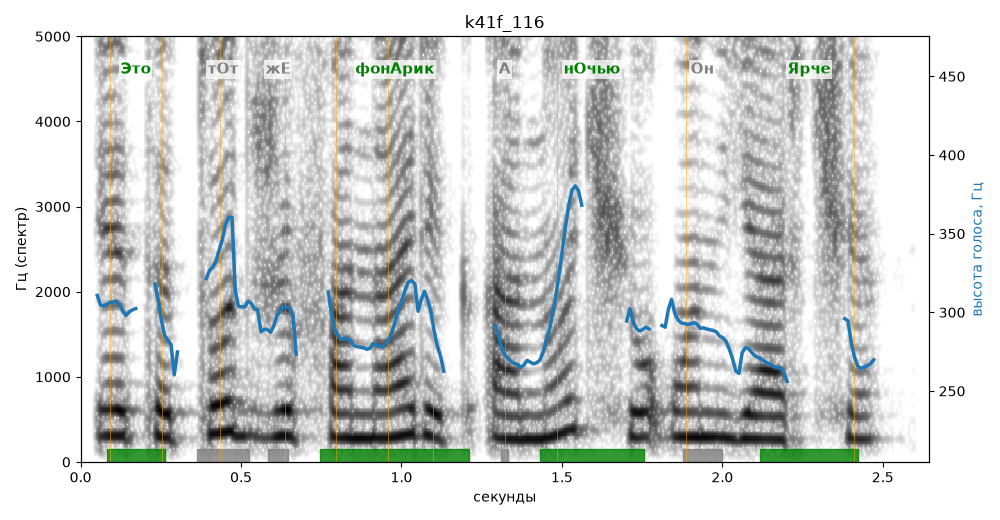

# k41f_116

Эталон: Это тот же фонарик! А ночью он ярче!
Распознано: Это тот же фонарик, а ночью он ярче.
Слова: все совпали

## Ударения
(где нужно: ruaccent)

| слово | нужно | у голоса | |
|---|---|---|---|
| это | Это | Это | ✓ |
| фонарик | фонАрик | фонАрик | ✓ |
| ночью | нОчью | нОчью | ✓ |
| ярче | Ярче | Ярче | ✓ |

## Интонация
- ✗ «это тот же фонарик!» — восклицание звучит ровно, без эмоции
- ✓ «а ночью он ярче!» — выделено слово «ночью» (+2.2 пт)
- Диапазон голоса 4.8 полутонов (нормально), средняя высота 290 Гц

## Паузы и темп
- после «фонарик!» пауза всего 0.10 с — фразы слипаются
- Темп 4.7 слога/с (нормально)

_Синяя линия — высота голоса. Над словами заглавная буква — где ударение должно быть; красным — голос поставил не туда (уверенно), оранжевым — возможно._
