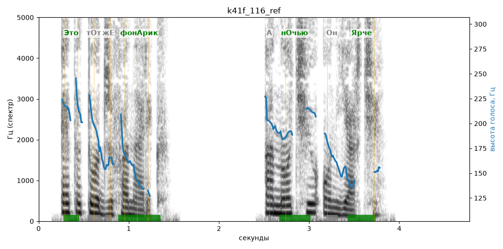

# k41f_116_ref

Голос: **edge:ru-RU-SvetlanaNeural** · длительность 4.8 с
Эталон: Это тот же фонарик! А ночью он ярче!
Распознано: Это тот же фонарик. Оно чью он ярче.
Расхождения в словах: «а ночью» → «оно чью»

## Ударения
(где нужно: ruaccent)

| слово | нужно | у голоса | |
|---|---|---|---|
| это | Это | Это | ✓ |
| фонарик | фонАрик | фонАрик | ✓ |
| ночью | нОчью | нОчью | ✓ |
| ярче | Ярче | Ярче | ✓ |

## Интонация
- ✓ «это тот же фонарик!» — выделено слово «это» (+4.5 пт)
- ✗ «а ночью он ярче!» — восклицание звучит ровно, без эмоции
- Диапазон голоса 8.2 полутонов (живо), средняя высота 176 Гц

## Паузы и темп
- паузы на своих местах
- Темп 5.3 слога/с (нормально)

_Синяя линия — высота голоса. Над словами заглавная буква — где ударение должно быть; красным — голос поставил не туда (уверенно), оранжевым — возможно._
