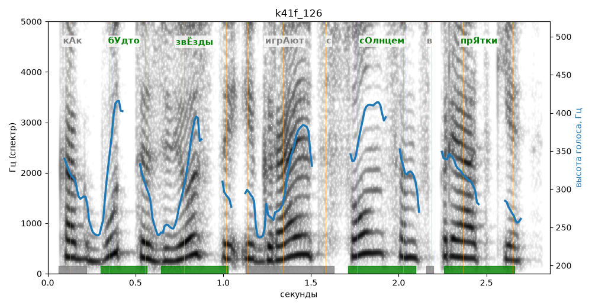

# k41f_126

Эталон: Как будто звёзды играют с солнцем в прятки!
Распознано: Как будто звезды играют с солнцем в прятке.
Расхождения в словах: «прятки» → «прятке»

## Ударения
(где нужно: ruaccent)

| слово | нужно | у голоса | |
|---|---|---|---|
| будто | бУдто | бУдто | ✓ |
| звёзды | звЁзды | звЁзды | ✓ |
| играют | игрАют | — | ? |
| солнцем | сОлнцем | сОлнцем | ✓ |
| прятки | прЯтки | прЯтки | ✓ |

## Интонация
- ✓ «как будто звёзды играют с солнцем в прятки!» — выделено слово «солнцем» (+4.8 пт)
- Диапазон голоса 9.2 полутонов (живо), средняя высота 312 Гц

## Паузы и темп
- паузы на своих местах
- Темп 5.0 слога/с (нормально)

_Синяя линия — высота голоса. Над словами заглавная буква — где ударение должно быть; красным — голос поставил не туда (уверенно), оранжевым — возможно._
