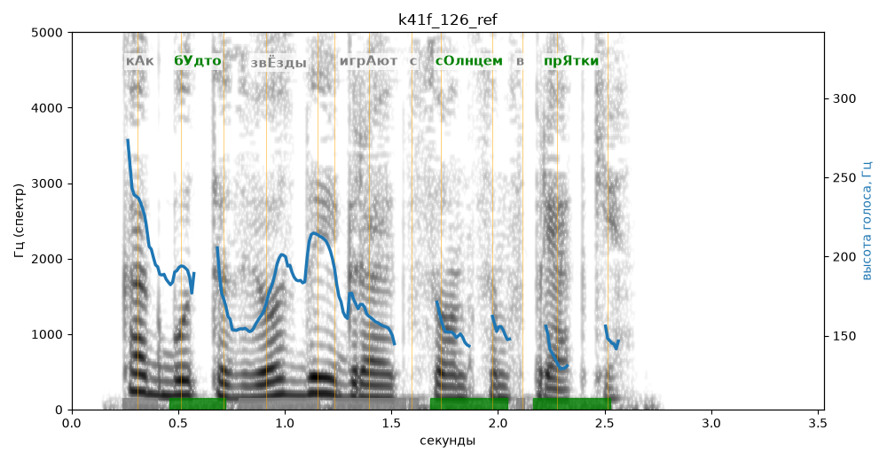

# k41f_126_ref

Голос: **edge:ru-RU-SvetlanaNeural** · длительность 3.5 с
Эталон: Как будто звёзды играют с солнцем в прятки!
Распознано: Как будто звезды играют с солнцем в прятки.
Слова: все совпали

## Ударения
(где нужно: ruaccent)

| слово | нужно | у голоса | |
|---|---|---|---|
| будто | бУдто | бУдто | ✓ |
| звёзды | звЁзды | звёздЫ | ? не разобрать |
| играют | игрАют | — | ? |
| солнцем | сОлнцем | сОлнцем | ✓ |
| прятки | прЯтки | прЯтки | ✓ |

## Интонация
- ✓ «как будто звёзды играют с солнцем в прятки!» — выделено слово «как» (+6.2 пт)
- Диапазон голоса 8.2 полутонов (живо), средняя высота 168 Гц

## Паузы и темп
- паузы на своих местах
- Темп 5.7 слога/с (нормально)

_Синяя линия — высота голоса. Над словами заглавная буква — где ударение должно быть; красным — голос поставил не туда (уверенно), оранжевым — возможно._
