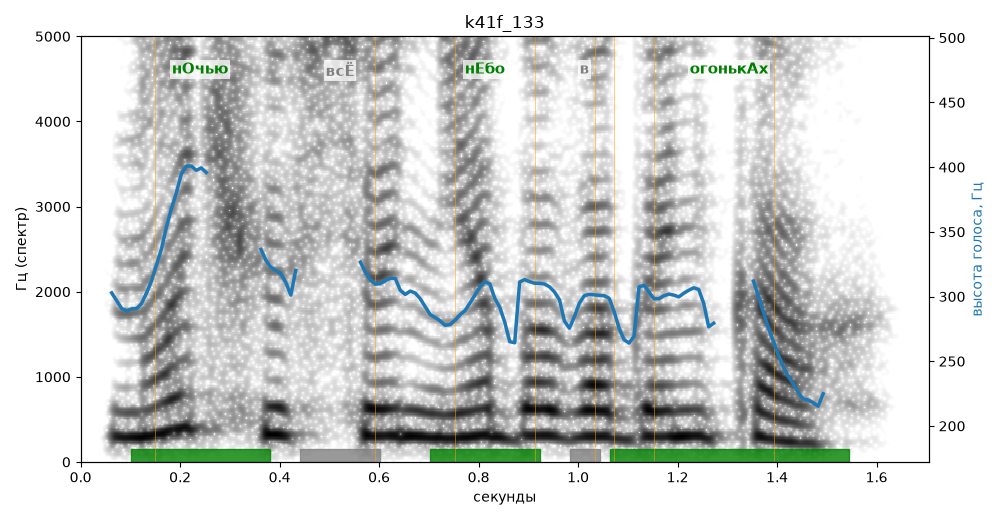

# k41f_133

Эталон: Ночью всё небо в огоньках.
Распознано: Ночью все не оба в огоньках.
Расхождения в словах: «небо» → «не оба»

## Ударения
(где нужно: ruaccent)

| слово | нужно | у голоса | |
|---|---|---|---|
| ночью | нОчью | нОчью | ✓ |
| небо | нЕбо | нЕбо | ✓ |
| огоньках | огонькАх | огонькАх | ✓ |

## Интонация
- ✓ «ночью всё небо в огоньках.» — конец фразы понижается — звучит законченно
- Диапазон голоса 8.9 полутонов (живо), средняя высота 301 Гц

## Паузы и темп
- паузы на своих местах
- Темп 5.5 слога/с (нормально)

_Синяя линия — высота голоса. Над словами заглавная буква — где ударение должно быть; красным — голос поставил не туда (уверенно), оранжевым — возможно._
