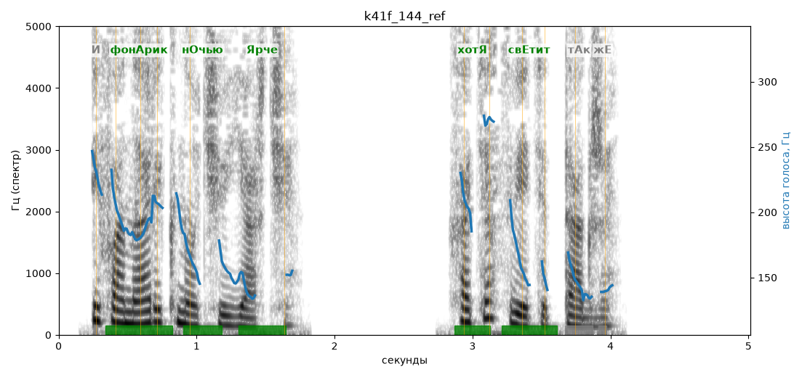

# k41f_144_ref

Голос: **edge:ru-RU-SvetlanaNeural** · длительность 5.0 с
Эталон: И фонарик ночью ярче. Хотя светит так же.
Распознано: И фонарик ночью ярче. Хотя светит также.
Расхождения в словах: «так же» → «также»

## Ударения
(где нужно: ruaccent)

| слово | нужно | у голоса | |
|---|---|---|---|
| фонарик | фонАрик | фонАрик | ✓ |
| ночью | нОчью | нОчью | ✓ |
| ярче | Ярче | Ярче | ✓ |
| хотя | хотЯ | хотЯ | ✓ |
| светит | свЕтит | свЕтит | ✓ |

## Интонация
- ✓ «и фонарик ночью ярче.» — конец фразы понижается — звучит законченно
- ✓ «хотя светит так же.» — конец фразы понижается — звучит законченно
- Диапазон голоса 10.4 полутонов (живо), средняя высота 170 Гц

## Паузы и темп
- паузы на своих местах
- Темп 4.8 слога/с (нормально)

_Синяя линия — высота голоса. Над словами заглавная буква — где ударение должно быть; красным — голос поставил не туда (уверенно), оранжевым — возможно._
