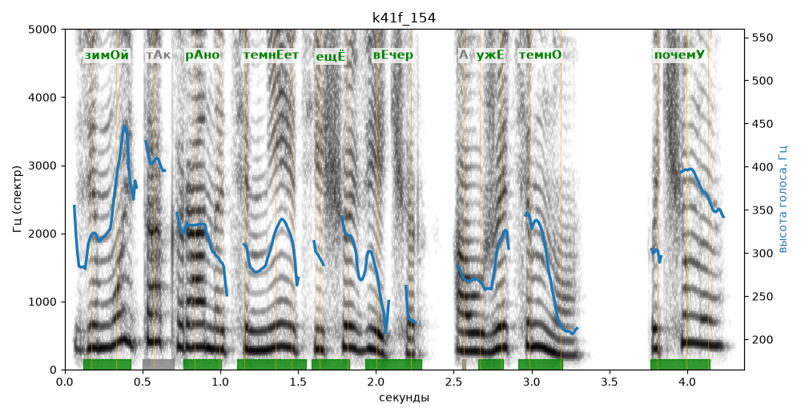

# k41f_154

Эталон: Зимой так рано темнеет! Ещё вечер, а уже темно. Почему?
Распознано: Зимой так рано темнеет еще вечер, а уже темно. Почему?
Слова: все совпали

## Ударения
(где нужно: ruaccent)

| слово | нужно | у голоса | |
|---|---|---|---|
| зимой | зимОй | зимОй | ✓ |
| рано | рАно | рАно | ✓ |
| темнеет | темнЕет | темнЕет | ✓ |
| ещё | ещЁ | ещЁ | ✓ |
| вечер | вЕчер | вЕчер | ✓ |
| уже | ужЕ | ужЕ | ✓ |
| темно | темнО | темнО | ✓ |
| почему | почемУ | почемУ | ✓ |

## Интонация
- ✓ «зимой так рано темнеет!» — выделено слово «так» (+4.3 пт)
- ✓ «ещё вечер а уже темно.» — конец фразы понижается — звучит законченно
- ✗ «почему?» — конец фразы не понижается — звучит незаконченно / как перечисление
- Диапазон голоса 10.5 полутонов (живо), средняя высота 313 Гц

## Паузы и темп
- после «темнеет!» пауза всего 0.04 с — фразы слипаются
- Темп 6.3 слога/с (нормально)

_Синяя линия — высота голоса. Над словами заглавная буква — где ударение должно быть; красным — голос поставил не туда (уверенно), оранжевым — возможно._
