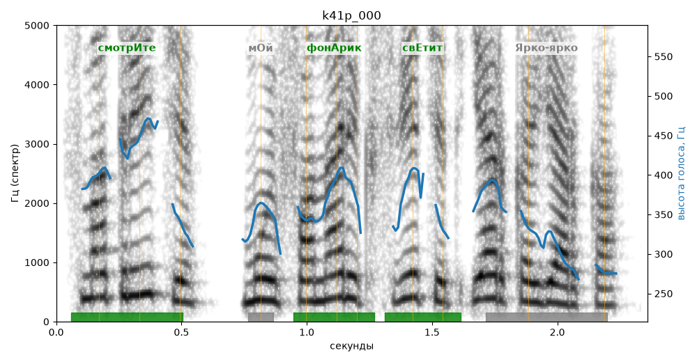

# k41p_000

Эталон: Смотрите, мой фонарик светит ярко-ярко!
Распознано: Смотрите, мой фанарик светит ярко- ярко!
Расхождения в словах: «фонарик» → «фанарик»; «ярко-ярко» → «ярко- ярко»

## Ударения
(где нужно: ruaccent)

| слово | нужно | у голоса | |
|---|---|---|---|
| смотрите | смотрИте | смотрИте | ✓ |
| фонарик | фонАрик | фонАрик | ✓ |
| светит | свЕтит | свЕтит | ✓ |
| ярко-ярко | Ярко-ярко | — | ? |

## Интонация
- ✓ «смотрите мой фонарик светит ярко-ярко!» — выделено слово «смотрите» (+4.5 пт)
- Диапазон голоса 8.3 полутонов (живо), средняя высота 356 Гц

## Паузы и темп
- паузы на своих местах
- Темп 5.9 слога/с (нормально)

_Синяя линия — высота голоса. Над словами заглавная буква — где ударение должно быть; красным — голос поставил не туда (уверенно), оранжевым — возможно._
