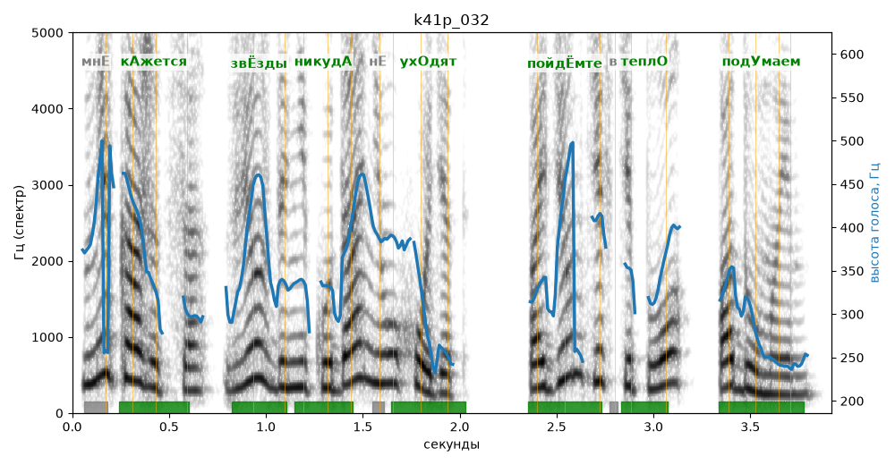

# k41p_032

Эталон: Мне кажется, звёзды никуда не уходят. Пойдёмте в тепло, подумаем.
Распознано: Мне кажется, звезды никуда не уходят. Пойдемте в тепло, подумаем.
Слова: все совпали

## Ударения
(где нужно: ruaccent)

| слово | нужно | у голоса | |
|---|---|---|---|
| кажется | кАжется | кАжется | ✓ |
| звёзды | звЁзды | звЁзды | ✓ |
| никуда | никудА | никудА | ✓ |
| уходят | ухОдят | ухОдят | ✓ |
| пойдёмте | пойдЁмте | пойдЁмте | ✓ |
| тепло | теплО | теплО | ✓ |
| подумаем | подУмаем | подУмаем | ✓ |

## Интонация
- ✓ «мне кажется звёзды никуда не уходят.» — конец фразы понижается — звучит законченно
- ✓ «пойдёмте в тепло подумаем.» — конец фразы понижается — звучит законченно
- Диапазон голоса 11.1 полутонов (живо), средняя высота 337 Гц

## Паузы и темп
- паузы на своих местах
- Темп 7.9 слога/с (быстро)

_Синяя линия — высота голоса. Над словами заглавная буква — где ударение должно быть; красным — голос поставил не туда (уверенно), оранжевым — возможно._
