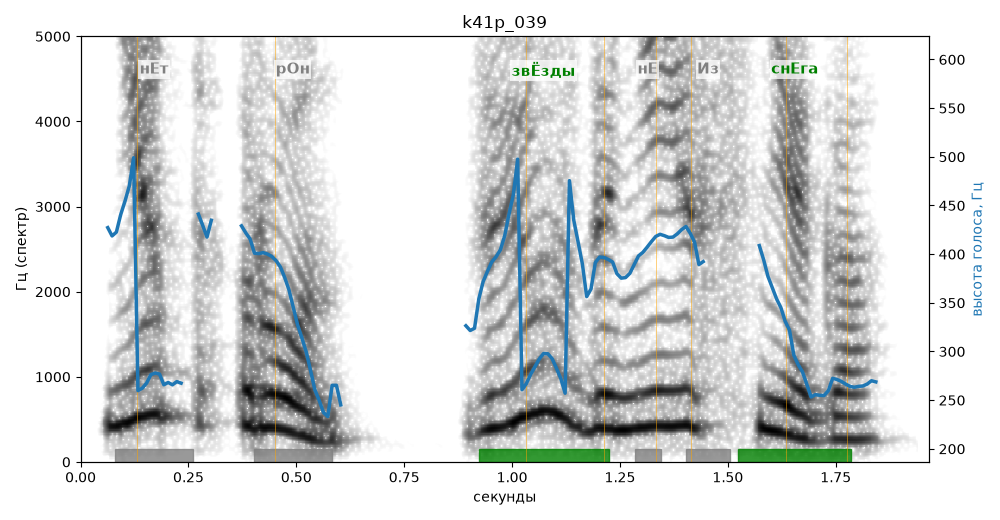

# k41p_039

Эталон: Нет, Рон. Звёзды не из снега.
Распознано: Нет крон, звезда не из снега.
Расхождения в словах: «рон звезды» → «крон звезда»

## Ударения
(где нужно: ruaccent)

| слово | нужно | у голоса | |
|---|---|---|---|
| звёзды | звЁзды | звЁзды | ✓ |
| снега | снЕга | снЕга | ✓ |

## Интонация
- ✓ «звёзды не из снега.» — конец фразы понижается — звучит законченно
- Диапазон голоса 9.5 полутонов (живо), средняя высота 365 Гц

## Паузы и темп
- паузы на своих местах
- Темп 5.9 слога/с (нормально)

_Синяя линия — высота голоса. Над словами заглавная буква — где ударение должно быть; красным — голос поставил не туда (уверенно), оранжевым — возможно._
