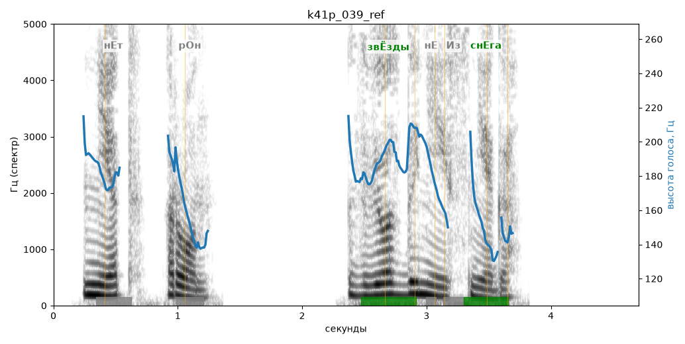

# k41p_039_ref

Голос: **edge:ru-RU-SvetlanaNeural** · длительность 4.7 с
Эталон: Нет, Рон. Звёзды не из сн+ега.
Распознано: Нет, Рон. Звезды ней снега.
Расхождения в словах: «не из» → «ней»

## Ударения
(где нужно: дано в тексте)

| слово | нужно | у голоса | |
|---|---|---|---|
| звёзды | звЁзды | звЁзды | ✓ |
| снега | снЕга | снЕга | ✓ |

## Интонация
- ✓ «звёзды не из снега.» — конец фразы понижается — звучит законченно
- Диапазон голоса 6.9 полутонов (нормально), средняя высота 180 Гц

## Паузы и темп
- паузы на своих местах
- Темп 4.7 слога/с (нормально)

_Синяя линия — высота голоса. Над словами заглавная буква — где ударение должно быть; красным — голос поставил не туда (уверенно), оранжевым — возможно._
