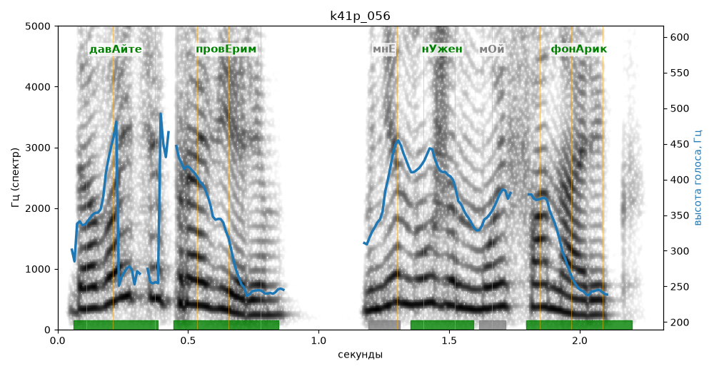

# k41p_056

Эталон: Давайте проверим. Мне нужен мой фонарик.
Распознано: Давайте проверим, мне нужен мой фонарик.
Слова: все совпали

## Ударения
(где нужно: ruaccent)

| слово | нужно | у голоса | |
|---|---|---|---|
| давайте | давАйте | давАйте | ✓ |
| проверим | провЕрим | провЕрим | ✓ |
| нужен | нУжен | нУжен | ✓ |
| фонарик | фонАрик | фонАрик | ✓ |

## Интонация
- ✓ «давайте проверим.» — конец фразы понижается — звучит законченно
- ✓ «мне нужен мой фонарик.» — конец фразы понижается — звучит законченно
- Диапазон голоса 10.7 полутонов (живо), средняя высота 346 Гц

## Паузы и темп
- паузы на своих местах
- Темп 7.2 слога/с (быстро)

_Синяя линия — высота голоса. Над словами заглавная буква — где ударение должно быть; красным — голос поставил не туда (уверенно), оранжевым — возможно._
