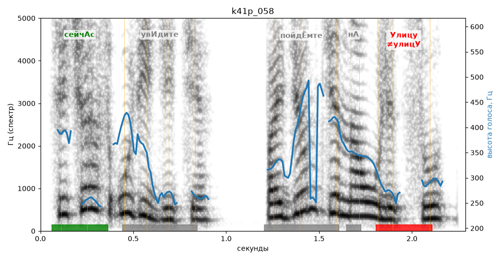

# k41p_058

Эталон: Сейчас увидите. Пойдёмте на улицу!
Распознано: Сейчас увидите. Пойдемте на улицу.
Слова: все совпали

## Ударения
(где нужно: ruaccent)

| слово | нужно | у голоса | |
|---|---|---|---|
| сейчас | сейчАс | сейчАс | ✓ |
| увидите | увИдите | Увидите | ? не разобрать |
| пойдёмте | пойдЁмте | пойдёмтЕ | ? не разобрать |
| улицу | Улицу | улицУ | ✗ ОШИБКА |

## Интонация
- ✗ «сейчас увидите.» — конец фразы не понижается — звучит незаконченно / как перечисление
- ✓ «пойдёмте на улицу!» — выделено слово «пойдёмте» (+3.5 пт)
- Диапазон голоса 10.4 полутонов (живо), средняя высота 320 Гц

## Паузы и темп
- паузы на своих местах
- Темп 7.7 слога/с (быстро)

_Синяя линия — высота голоса. Над словами заглавная буква — где ударение должно быть; красным — голос поставил не туда (уверенно), оранжевым — возможно._
