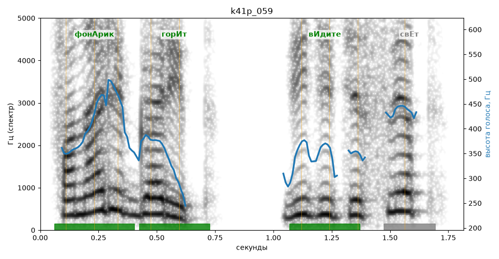

# k41p_059

Эталон: Фонарик горит. Видите свет?
Распознано: Фанарик Гарриб, видите, слегка?
Расхождения в словах: «фонарик горит» → «фанарик гарриб»; «свет» → «слегка»

## Ударения
(где нужно: ruaccent)

| слово | нужно | у голоса | |
|---|---|---|---|
| фонарик | фонАрик | фонАрик | ✓ |
| горит | горИт | горИт | ✓ |
| видите | вИдите | вИдите | ✓ |

## Интонация
- ✓ «фонарик горит.» — конец фразы понижается — звучит законченно
- ✓ «видите свет?» — вопросительный подъём на слове «свет»
- Диапазон голоса 8.2 полутонов (живо), средняя высота 368 Гц

## Паузы и темп
- паузы на своих местах
- Темп 7.0 слога/с (быстро)

_Синяя линия — высота голоса. Над словами заглавная буква — где ударение должно быть; красным — голос поставил не туда (уверенно), оранжевым — возможно._
