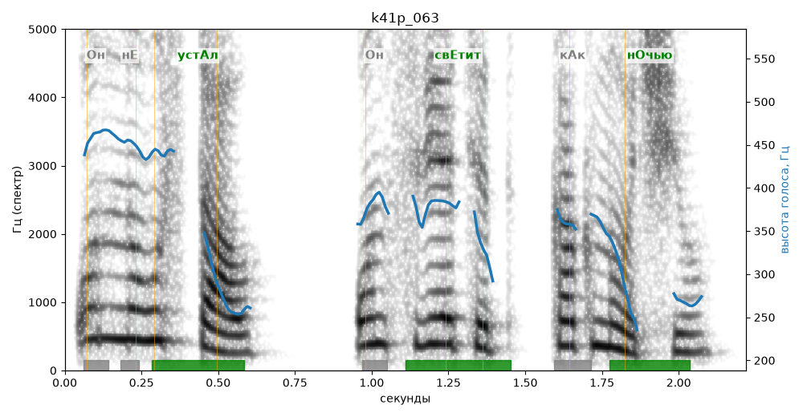

# k41p_063

Эталон: Он не устал. Он светит, как ночью.
Распознано: Он на устал, он светит как ночью.
Расхождения в словах: «не» → «на»

## Ударения
(где нужно: ruaccent)

| слово | нужно | у голоса | |
|---|---|---|---|
| устал | устАл | устАл | ✓ |
| светит | свЕтит | свЕтит | ✓ |
| ночью | нОчью | нОчью | ✓ |

## Интонация
- ✓ «он не устал.» — конец фразы понижается — звучит законченно
- ✓ «он светит как ночью.» — конец фразы понижается — звучит законченно
- Диапазон голоса 10.3 полутонов (живо), средняя высота 366 Гц

## Паузы и темп
- паузы на своих местах
- Темп 5.6 слога/с (нормально)

_Синяя линия — высота голоса. Над словами заглавная буква — где ударение должно быть; красным — голос поставил не туда (уверенно), оранжевым — возможно._
