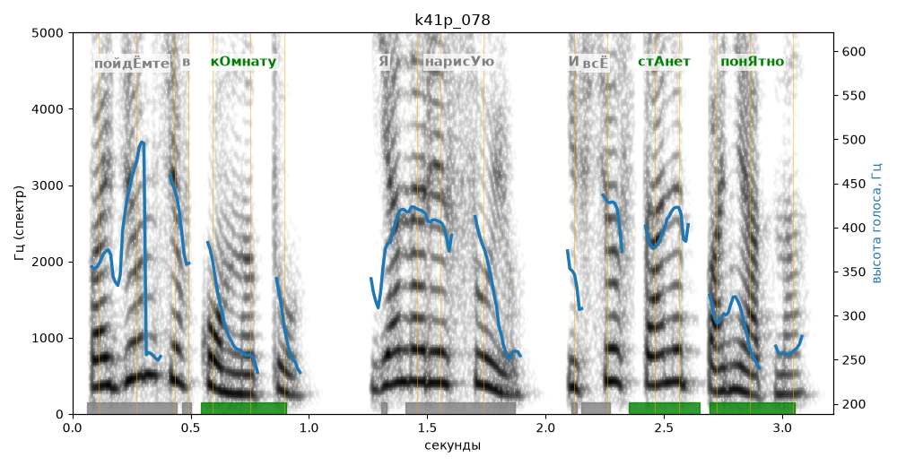

# k41p_078

Эталон: Пойдёмте в комнату. Я нарисую, и всё станет понятно.
Распознано: Пойдемте в комнату, я нарисую, и все станет понятно.
Слова: все совпали

## Ударения
(где нужно: ruaccent)

| слово | нужно | у голоса | |
|---|---|---|---|
| пойдёмте | пойдЁмте | пойдёмтЕ | ? не разобрать |
| комнату | кОмнату | кОмнату | ✓ |
| нарисую | нарисУю | — | ? |
| станет | стАнет | стАнет | ✓ |
| понятно | понЯтно | понЯтно | ✓ |

## Интонация
- ✓ «пойдёмте в комнату.» — конец фразы понижается — звучит законченно
- ✓ «я нарисую и всё станет понятно.» — конец фразы понижается — звучит законченно
- Диапазон голоса 9.7 полутонов (живо), средняя высота 352 Гц

## Паузы и темп
- паузы на своих местах
- Темп 7.2 слога/с (быстро)

_Синяя линия — высота голоса. Над словами заглавная буква — где ударение должно быть; красным — голос поставил не туда (уверенно), оранжевым — возможно._
