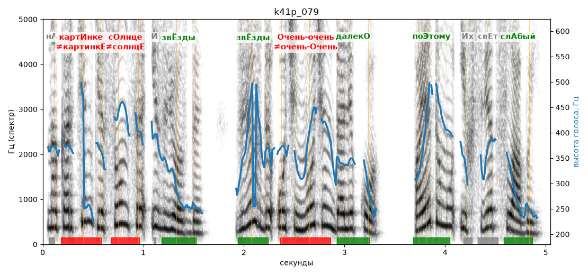

# k41p_079

Эталон: На картинке солнце и звёзды. Звёзды очень-очень далеко. Поэтому их свет слабый.
Распознано: На картинке солнце из резды. Звезды очень очень далеко, поэтому их свет слабый.
Расхождения в словах: «и» → «из резды»; «звезды очень-очень» → «очень очень»

## Ударения
(где нужно: ruaccent)

| слово | нужно | у голоса | |
|---|---|---|---|
| картинке | картИнке | картинкЕ | ✗ ОШИБКА |
| солнце | сОлнце | солнцЕ | ✗ ОШИБКА |
| звёзды | звЁзды | звЁзды | ✓ |
| звёзды | звЁзды | звЁзды | ✓ |
| очень-очень | Очень-очень | очень-Очень | ✗ ОШИБКА |
| далеко | далекО | далекО | ✓ |
| поэтому | поЭтому | поЭтому | ✓ |
| слабый | слАбый | слАбый | ✓ |

## Интонация
- ✓ «на картинке солнце и звёзды.» — конец фразы понижается — звучит законченно
- ✓ «звёзды очень-очень далеко.» — конец фразы понижается — звучит законченно
- ✓ «поэтому их свет слабый.» — конец фразы понижается — звучит законченно
- Диапазон голоса 10.9 полутонов (живо), средняя высота 354 Гц

## Паузы и темп
- паузы на своих местах
- Темп 6.6 слога/с (быстро)

_Синяя линия — высота голоса. Над словами заглавная буква — где ударение должно быть; красным — голос поставил не туда (уверенно), оранжевым — возможно._
