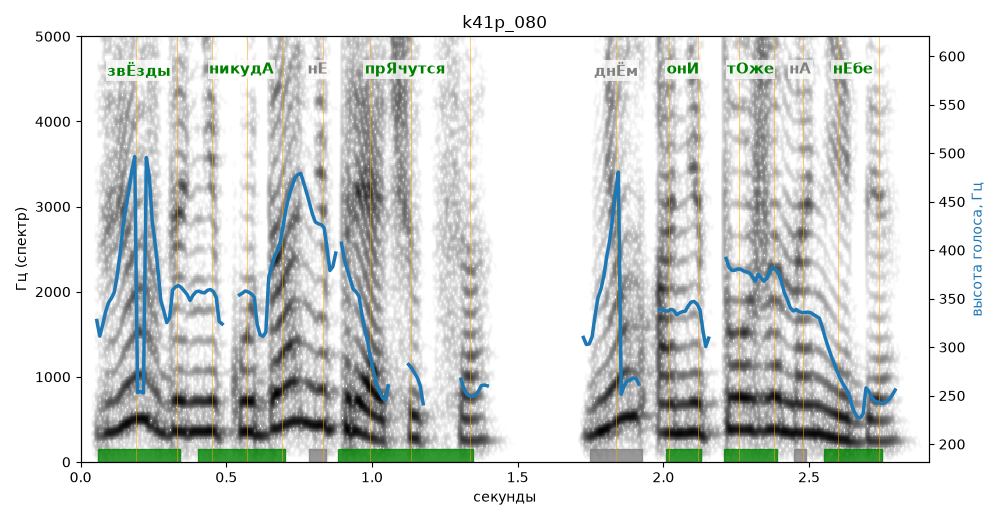

# k41p_080

Эталон: Звёзды никуда не прячутся. Днём они тоже на небе.
Распознано: Звезды никуда не прячутся. Днем они тоже на небе.
Слова: все совпали

## Ударения
(где нужно: ruaccent)

| слово | нужно | у голоса | |
|---|---|---|---|
| звёзды | звЁзды | звЁзды | ✓ |
| никуда | никудА | никудА | ✓ |
| прячутся | прЯчутся | прЯчутся | ✓ |
| они | онИ | онИ | ✓ |
| тоже | тОже | тОже | ✓ |
| небе | нЕбе | нЕбе | ✓ |

## Интонация
- ✓ «звёзды никуда не прячутся.» — конец фразы понижается — звучит законченно
- ✓ «днём они тоже на небе.» — конец фразы понижается — звучит законченно
- Диапазон голоса 11.0 полутонов (живо), средняя высота 340 Гц

## Паузы и темп
- паузы на своих местах
- Темп 7.4 слога/с (быстро)

_Синяя линия — высота голоса. Над словами заглавная буква — где ударение должно быть; красным — голос поставил не туда (уверенно), оранжевым — возможно._
