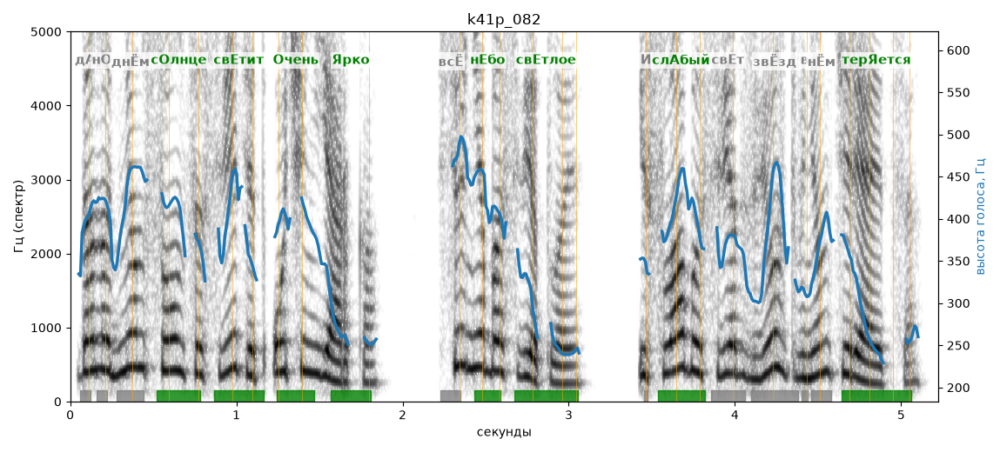

# k41p_082

Эталон: Да! Но днём солнце светит очень ярко. Всё небо светлое. И слабый свет звёзд в нём теряется.
Распознано: Да над ним солнце светит очень ярко. Все небо светлой. И слабо свет звезд в нем теряется.
Расхождения в словах: «но днем» → «над ним»; «светлое» → «светлой»; «слабый» → «слабо»

## Ударения
(где нужно: ruaccent)

| слово | нужно | у голоса | |
|---|---|---|---|
| солнце | сОлнце | сОлнце | ✓ |
| светит | свЕтит | свЕтит | ✓ |
| очень | Очень | Очень | ✓ |
| ярко | Ярко | Ярко | ✓ |
| небо | нЕбо | нЕбо | ✓ |
| светлое | свЕтлое | свЕтлое | ✓ |
| слабый | слАбый | слАбый | ✓ |
| теряется | терЯется | терЯется | ✓ |

## Интонация
- ✓ «но днём солнце светит очень ярко.» — конец фразы понижается — звучит законченно
- ✓ «всё небо светлое.» — конец фразы понижается — звучит законченно
- ✓ «и слабый свет звёзд в нём теряется.» — конец фразы понижается — звучит законченно
- Диапазон голоса 10.9 полутонов (живо), средняя высота 374 Гц

## Паузы и темп
- после «да!» пауза всего 0.04 с — фразы слипаются
- Темп 6.5 слога/с (нормально)

_Синяя линия — высота голоса. Над словами заглавная буква — где ударение должно быть; красным — голос поставил не туда (уверенно), оранжевым — возможно._
