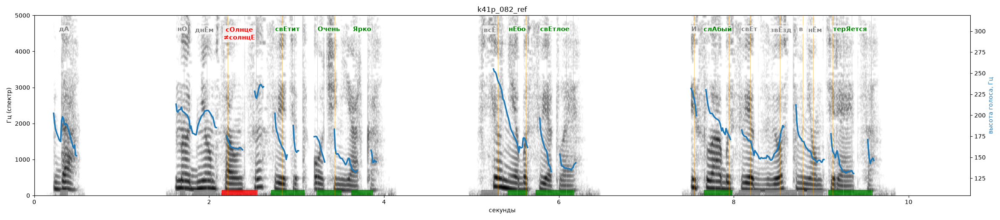

# k41p_082_ref

Голос: **edge:ru-RU-SvetlanaNeural** · длительность 10.7 с
Эталон: Да! Но днём с+олнце светит очень ярко. Всё небо светлое. И слабый свет звёзд в нём теряется.
Распознано: Да. Но днем Солнце светит очень ярко. Все необы светлое. И слабый свет звезд в нем теряется.
Расхождения в словах: «небо» → «необы»

## Ударения
(где нужно: ruaccent)

| слово | нужно | у голоса | |
|---|---|---|---|
| солнце | сОлнце | солнцЕ | ✗ ОШИБКА |
| светит | свЕтит | свЕтит | ✓ |
| очень | Очень | Очень | ✓ |
| ярко | Ярко | Ярко | ✓ |
| небо | нЕбо | нЕбо | ✓ |
| светлое | свЕтлое | свЕтлое | ✓ |
| слабый | слАбый | слАбый | ✓ |
| теряется | терЯется | терЯется | ✓ |

## Интонация
- ✓ «но днём солнце светит очень ярко.» — конец фразы понижается — звучит законченно
- ✓ «всё небо светлое.» — конец фразы понижается — звучит законченно
- ✓ «и слабый свет звёзд в нём теряется.» — конец фразы понижается — звучит законченно
- Диапазон голоса 9.2 полутонов (живо), средняя высота 167 Гц

## Паузы и темп
- паузы на своих местах
- Темп 5.2 слога/с (нормально)

_Синяя линия — высота голоса. Над словами заглавная буква — где ударение должно быть; красным — голос поставил не туда (уверенно), оранжевым — возможно._
