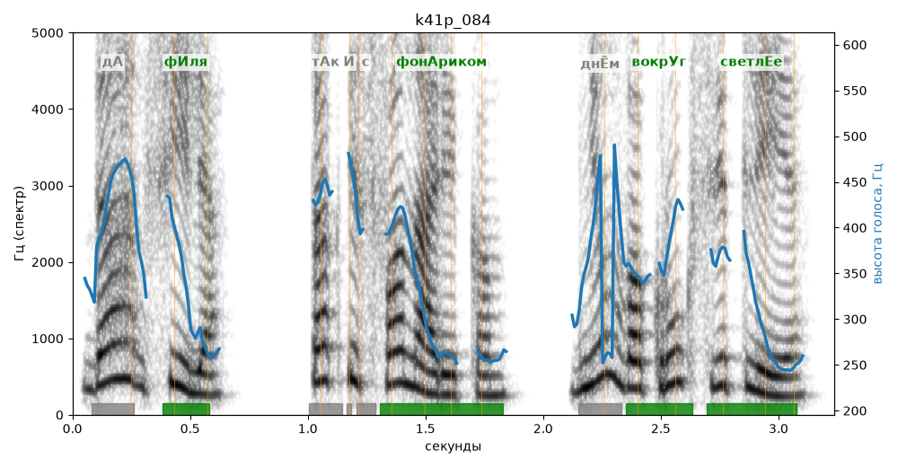

# k41p_084

Эталон: Да, Филя. Так и с фонариком: днём вокруг светлее.
Распознано: Да, Фили, так не с фанариком, днем вокруг светлее.
Расхождения в словах: «филя» → «фили»; «и» → «не»; «фонариком» → «фанариком»

## Ударения
(где нужно: ruaccent)

| слово | нужно | у голоса | |
|---|---|---|---|
| филя | фИля | фИля | ✓ |
| фонариком | фонАриком | фонАриком | ✓ |
| вокруг | вокрУг | вокрУг | ✓ |
| светлее | светлЕе | светлЕе | ✓ |

## Интонация
- ✗ «да филя.» — конец фразы не понижается — звучит незаконченно / как перечисление
- ✓ «так и с фонариком днём вокруг светлее.» — конец фразы понижается — звучит законченно
- Диапазон голоса 10.6 полутонов (живо), средняя высота 349 Гц

## Паузы и темп
- паузы на своих местах
- Темп 7.1 слога/с (быстро)

_Синяя линия — высота голоса. Над словами заглавная буква — где ударение должно быть; красным — голос поставил не туда (уверенно), оранжевым — возможно._
