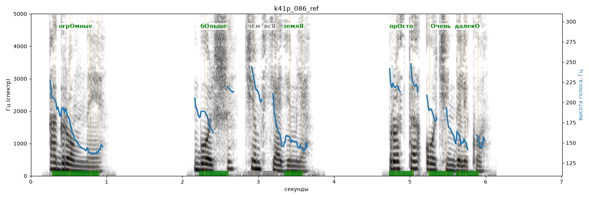

# k41p_086_ref

Голос: **edge:ru-RU-SvetlanaNeural** · длительность 7.0 с
Эталон: Огромные! Больше, чем вся Земля. Просто очень далеко.
Распознано: Огромные. Больше, чем вся земля. Просто очень далеко.
Слова: все совпали

## Ударения
(где нужно: ruaccent)

| слово | нужно | у голоса | |
|---|---|---|---|
| огромные | огрОмные | огрОмные | ✓ |
| больше | бОльше | бОльше | ✓ |
| земля | землЯ | землЯ | ✓ |
| просто | прОсто | прОсто | ✓ |
| очень | Очень | Очень | ✓ |
| далеко | далекО | далекО | ✓ |

## Интонация
- ✓ «огромные!» — выделено слово «огромные» (+2.0 пт)
- ✓ «больше чем вся земля.» — конец фразы понижается — звучит законченно
- ✓ «просто очень далеко.» — конец фразы понижается — звучит законченно
- Диапазон голоса 8.1 полутонов (живо), средняя высота 168 Гц

## Паузы и темп
- паузы на своих местах
- Темп 6.3 слога/с (нормально)

_Синяя линия — высота голоса. Над словами заглавная буква — где ударение должно быть; красным — голос поставил не туда (уверенно), оранжевым — возможно._
