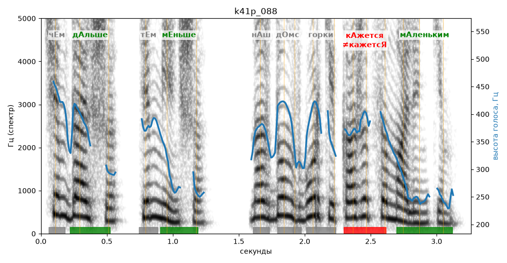

# k41p_088

Эталон: Чем дальше, тем меньше. Наш дом с горки кажется маленьким.
Распознано: Чем дальше, тем меньше. Наш дом с горки кажется маленьким.
Слова: все совпали

## Ударения
(где нужно: ruaccent)

| слово | нужно | у голоса | |
|---|---|---|---|
| дальше | дАльше | дАльше | ✓ |
| меньше | мЕньше | мЕньше | ✓ |
| горки | горки | гОрки | нет эталона |
| кажется | кАжется | кажетсЯ | ✗ ОШИБКА |
| маленьким | мАленьким | мАленьким | ✓ |

## Интонация
- ✓ «чем дальше тем меньше.» — конец фразы понижается — звучит законченно
- ✓ «наш дом с горки кажется маленьким.» — конец фразы понижается — звучит законченно
- Диапазон голоса 9.5 полутонов (живо), средняя высота 355 Гц

## Паузы и темп
- паузы на своих местах
- Темп 7.0 слога/с (быстро)

_Синяя линия — высота голоса. Над словами заглавная буква — где ударение должно быть; красным — голос поставил не туда (уверенно), оранжевым — возможно._
