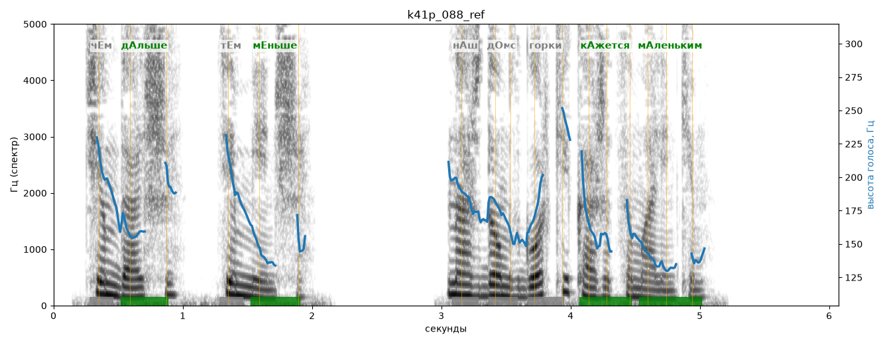

# k41p_088_ref

Голос: **edge:ru-RU-SvetlanaNeural** · длительность 6.1 с
Эталон: Чем дальше, тем меньше. Наш дом с горки кажется маленьким.
Распознано: Чем дальше, тем меньше. Наждом с горки кажется маленьким.
Расхождения в словах: «наш дом» → «наждом»

## Ударения
(где нужно: ruaccent)

| слово | нужно | у голоса | |
|---|---|---|---|
| дальше | дАльше | дАльше | ✓ |
| меньше | мЕньше | мЕньше | ✓ |
| горки | горки | гОрки | нет эталона |
| кажется | кАжется | кАжется | ✓ |
| маленьким | мАленьким | мАленьким | ✓ |

## Интонация
- ✓ «чем дальше тем меньше.» — конец фразы понижается — звучит законченно
- ✓ «наш дом с горки кажется маленьким.» — конец фразы понижается — звучит законченно
- Диапазон голоса 8.3 полутонов (живо), средняя высота 164 Гц

## Паузы и темп
- паузы на своих местах
- Темп 5.4 слога/с (нормально)

_Синяя линия — высота голоса. Над словами заглавная буква — где ударение должно быть; красным — голос поставил не туда (уверенно), оранжевым — возможно._
