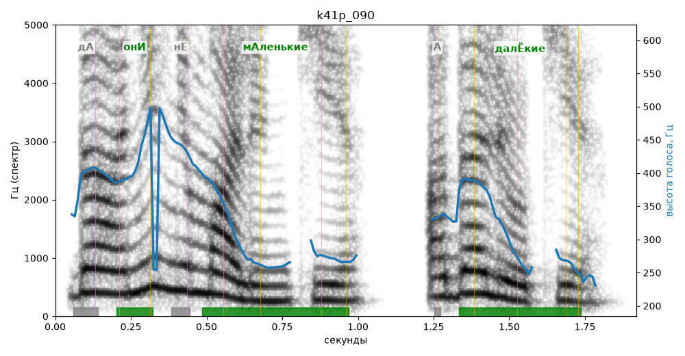

# k41p_090

Эталон: Да! Они не маленькие, а далёкие.
Распознано: Да, не немаленький, а далеки.
Расхождения в словах: «они» → «»; «маленькие» → «немаленький»; «далекие» → «далеки»

## Ударения
(где нужно: ruaccent)

| слово | нужно | у голоса | |
|---|---|---|---|
| они | онИ | онИ | ✓ |
| маленькие | мАленькие | мАленькие | ✓ |
| далёкие | далЁкие | далЁкие | ✓ |

## Интонация
- ✓ «они не маленькие а далёкие.» — конец фразы понижается — звучит законченно
- Диапазон голоса 10.3 полутонов (живо), средняя высота 332 Гц

## Паузы и темп
- после «да!» пауза всего 0.06 с — фразы слипаются
- Темп 9.3 слога/с (быстро)

_Синяя линия — высота голоса. Над словами заглавная буква — где ударение должно быть; красным — голос поставил не туда (уверенно), оранжевым — возможно._
