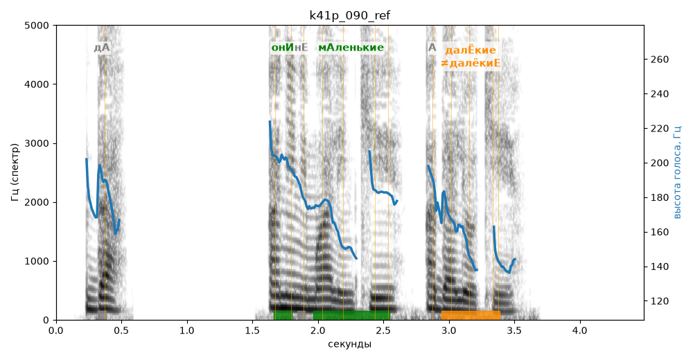

# k41p_090_ref

Голос: **edge:ru-RU-SvetlanaNeural** · длительность 4.5 с
Эталон: Да! Они не маленькие, а далёкие.
Распознано: Да. Они немаленькие, а далёкие.
Расхождения в словах: «не маленькие» → «немаленькие»

## Ударения
(где нужно: ruaccent)

| слово | нужно | у голоса | |
|---|---|---|---|
| они | онИ | онИ | ✓ |
| маленькие | мАленькие | мАленькие | ✓ |
| далёкие | далЁкие | далёкиЕ | ✗? возможно — послушать |

## Интонация
- ✓ «они не маленькие а далёкие.» — конец фразы понижается — звучит законченно
- Диапазон голоса 6.5 полутонов (нормально), средняя высота 175 Гц

## Паузы и темп
- паузы на своих местах
- Темп 8.9 слога/с (быстро)

_Синяя линия — высота голоса. Над словами заглавная буква — где ударение должно быть; красным — голос поставил не туда (уверенно), оранжевым — возможно._
